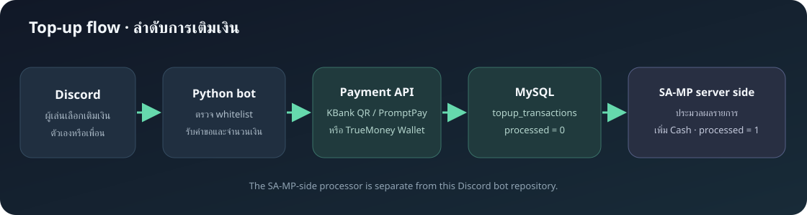
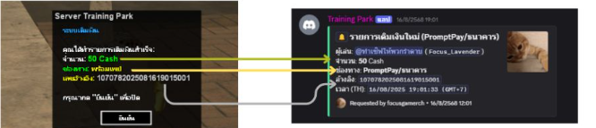
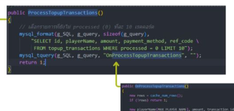
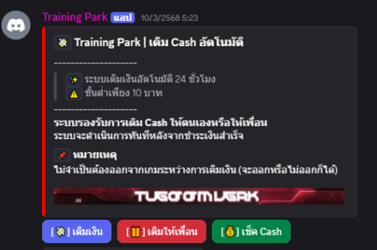
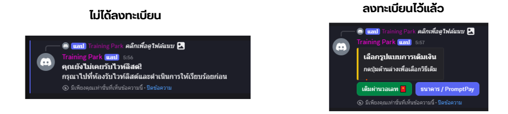
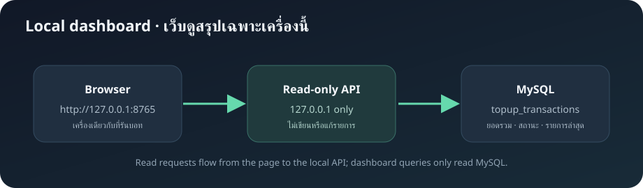

# SA-MP Top-up Discord Bot

บอท Discord สำหรับระบบเติม Cash ให้ผู้เล่น SA-MP พัฒนาด้วย Python และใช้ MySQL เป็นจุดเชื่อมระหว่างคำขอเติมเงินกับระบบฝั่งเกม รองรับเติมให้ตัวเองหรือให้เพื่อน ตรวจสอบยอด Cash และมีหน้าเว็บ local สำหรับดูสรุปรายการ

> **ช่องทางธนาคารปัจจุบัน:** ตั้งค่าไว้สำหรับ KBank QR/PromptPay ผ่าน payment provider API การยืนยันในโค้ดบอททำโดยเรียก API ตรวจรายการเมื่อผู้ใช้กดปุ่มยืนยัน ไม่พบ webhook callback endpoint ใน source ของบอทชุดนี้
>
> **ช่องทางเพิ่มเติม:** รองรับ TrueMoney Wallet แบบซองอั่งเปา การชำระเงินออกแบบสำหรับประเทศไทย ผู้พัฒนาสามารถเพิ่ม bank adapter หรือ webhook receiver สำหรับธนาคารอื่นต่อได้

## การทำงาน

1. ผู้ใช้กด **เติมเงิน**, **เติมให้เพื่อน**, หรือ **เช็ค Cash** ใน Discord บัญชี Discord ต้องผูกกับตัวละครใน whitelist ก่อน
2. บอทอ่านข้อมูลผู้เล่นจาก MySQL ตาราง `players` หากเติมให้เพื่อน บอทตรวจชื่อผู้รับกับฐานข้อมูลด้วย
3. สำหรับ KBank QR/PromptPay บอทขอสร้างรายการและ QR จาก payment provider API ส่ง QR ให้ผู้ใช้ แล้วตรวจสถานะอีกครั้งเมื่อกด **ยืนยันการโอน**
4. สำหรับ TrueMoney Wallet ผู้ใช้ส่งลิงก์ซอง บอทตรวจรูปแบบและป้องกันการใช้ reference ซ้ำ ก่อนตรวจรับซองผ่าน API
5. เมื่อ API ยืนยันการชำระเงิน บอทเพิ่มแถวใน `topup_transactions` โดยกำหนด `processed = 0`
6. สคริปต์ `discord_topup.pwn` ฝั่ง SA-MP อ่านรายการค้างจากฐานข้อมูล เพิ่ม Cash ให้ผู้เล่น และอัปเดตสถานะเมื่อทำสำเร็จ

Repository นี้มี `discord_topup.pwn` สำหรับประมวลผลรายการเติมเงินฝั่ง SA-MP โดยอ่านธุรกรรม `processed = 0` ทุก 5 วินาที เติม Cash ให้ผู้เล่นออนไลน์หรือออฟไลน์ และอัปเดตสถานะรายการ โค้ดเป็นส่วนเสริมที่ต้องนำไปรวมกับ gamemode เดิม ซึ่งต้องมี `a_mysql`, `YSI_Coding\y_hooks`, การเชื่อมต่อ `g_SQL` และโครงสร้าง `playerData`/`pWallet` พร้อมฟังก์ชัน `UpdateplayerData` ให้ตรงกับเซิร์ฟเวอร์ก่อนใช้งาน

### ภาพตัวอย่างการทำงาน

ภาพด้านล่างเป็นตัวอย่างจากระบบ: หน้าจอในเกมจับคู่กับข้อความแจ้งรายการใน Discord, log ฝั่งเซิร์ฟเวอร์แสดงธุรกรรมที่ถูกประมวลผล และตัวอย่างโค้ดแสดงการอ่านรายการค้างจากฐานข้อมูล โปรดทราบว่าการเติม Cash ในเกมขึ้นอยู่กับ processor ฝั่ง SA-MP ที่ติดตั้งแยกจากบอท

| ขั้นตอน | ภาพประกอบ |
| --- | --- |
| QR/PromptPay และข้อความแจ้งรายการใน Discord |  |
| Log ยืนยันการประมวลผลรายการเติมเงินในเกม |  |
| ตัวอย่าง processor ฝั่งเซิร์ฟเวอร์อ่านรายการธุรกรรมค้าง |  |

## ปุ่มและคำสั่ง

โพสต์หลักมีปุ่ม **เติมเงิน**, **เติมให้เพื่อน**, **เช็ค Cash**, และลิงก์คู่มือ (เปลี่ยน URL ของลิงก์คู่มือใน `main.py` ก่อนใช้งานจริง) เมนูชำระเงินเลือกได้ระหว่างธนาคาร/PromptPay กับ TrueMoney Wallet ตามการตั้งค่า

คำสั่งผู้ดูแลใช้ prefix `!` และตรวจสิทธิ์จาก `OWNERS` ใน config:

- `!setuptopup` — ส่งโพสต์เมนูเติมเงิน
- `!refpup <message_id|-> [description]` — รีเฟรชหรือแก้คำอธิบายโพสต์
- `!topupoff [message_id]` — ปิดการเติมเงิน
- `!topupon [message_id]` — เปิดการเติมเงิน

### ภาพเมนู Discord และการตรวจสิทธิ์ผู้เล่น

ภาพแรกเป็นโพสต์เมนูหลัก มีปุ่มเติมให้ตัวเอง เติมให้เพื่อน และเช็ค Cash ภาพที่สองเปรียบเทียบกรณีที่บัญชียังไม่ผูกกับตัวละครใน whitelist (ระบบแจ้งให้ลงทะเบียนก่อน) กับกรณีที่ผูกแล้ว ซึ่งผู้ใช้ไปต่อเพื่อเลือก TrueMoney Wallet หรือธนาคาร/PromptPay ได้

| ตัวอย่าง | รายละเอียด |
| --- | --- |
|  | เมนูหลักที่ผู้ดูแลโพสต์ให้สมาชิกใช้งาน |
|  | บัญชีที่ยังไม่ผูกตัวละครต้องลงทะเบียนก่อน ส่วนบัญชีที่ผ่าน whitelist จะเลือกช่องทางชำระเงินได้ |

ข้อจำกัดในโค้ดปัจจุบัน: ขั้นต่ำ 10 บาท, สร้าง QR ได้ไม่เกิน 3 ครั้งต่อผู้ใช้ใน 5 นาที และปิดช่องทางธนาคาร/PromptPay เวลา 23:00–02:00 น. ตามเวลาไทย

## หน้าเว็บสรุป Top-up

รัน `python main.py` แล้วเปิด <http://127.0.0.1:8765> บนเครื่องเดียวกัน หน้าเว็บแสดงยอดรวม จำนวนรายการค้าง/สำเร็จ ยอดแยกตามช่องทาง และรายการล่าสุด พร้อมค้นหาชื่อผู้เล่นหรือรหัสอ้างอิง

เว็บเซิร์ฟเวอร์ bind เฉพาะ `127.0.0.1` และอ่าน MySQL อย่างเดียว ไม่สร้าง แก้ไข หรือลบรายการ ตารางจะแสดงได้สูงสุด 200 รายการล่าสุด หาก schema มีคอลัมน์เวลา หน้าจะแสดงเวลานั้นด้วย

## เริ่มใช้งาน

1. ใช้ Python 3.10 ขึ้นไปและ MySQL โดยเลือกฐานข้อมูลเดียวกับที่บอทและเซิร์ฟเวอร์ SA-MP ใช้
2. สร้างตารางธุรกรรมโดยรันไฟล์ [`sql/topup_transactions.sql`](sql/topup_transactions.sql) ในฐานข้อมูลนั้น ตาราง `players` ต้องมีอยู่แล้วจากระบบเกม
3. ติดตั้ง dependency: `pip install -r requirements.txt`
4. ตรวจและตั้งค่า `config.py` ให้ตรงกับ Discord server, MySQL และ payment provider ของคุณ
5. รัน `python main.py`

`config.py` เป็นไฟล์ตั้งค่าหลักที่บอทอ่านขณะทำงาน ให้ปรับค่าในไฟล์นี้ก่อนเริ่มใช้งาน

## การต่อยอดและเงื่อนไขการใช้

อนุญาตให้นำโค้ดไปศึกษาและพัฒนาต่อสำหรับการใช้งานที่ไม่ใช่เชิงพาณิชย์ โดยต้องคงเครดิตและข้อความ license ไว้ ห้ามขายโค้ด ขายฉบับดัดแปลง คิดค่าบริการเพื่อให้เข้าถึงบอท หรือรวมในบริการเสียเงิน หากต้องการใช้งานเชิงพาณิชย์ต้องได้รับอนุญาตเป็นลายลักษณ์อักษรจากเจ้าของโปรเจกต์ก่อน

เงื่อนไขฉบับเต็มอยู่ใน [`LICENSE`](LICENSE) เงื่อนไขนี้เป็น custom non-commercial license; โปรเจกต์จึงเป็น **source-available** ไม่ใช่ open-source license มาตรฐาน

---

## English

A Python Discord bot for SA-MP Cash top-ups. It uses MySQL to pass payment records to the game-side processor. Players can top up their linked character or a friend, check their Cash balance, and view a local transaction dashboard.

> **Current bank integration:** Configured for KBank QR/PromptPay through the payment-provider API. The bot verifies a payment by calling the provider API after the user presses the confirmation button; this bot source does not expose a webhook callback endpoint.
>
> **Additional payment method:** TrueMoney Wallet gift-envelope links are supported. Payments are intended for Thailand. Developers can extend the payment layer with other bank adapters or webhook receivers.

## How it works

1. A user selects **Top up**, **Top up a friend**, or **Check Cash** in Discord. Their Discord account must be linked to a whitelisted game character.
2. The bot reads player information from the MySQL `players` table. For a friend top-up, it also checks the recipient name against the player database.
3. For KBank QR/PromptPay, the bot requests a payment and QR from the provider, sends the QR to the user, then checks the payment after the user presses **Confirm Transfer**.
4. For TrueMoney Wallet, the user submits a gift-envelope link. The bot validates the link and rejects a reference already used before checking the envelope through the API.
5. After successful payment verification, the bot inserts a row in `topup_transactions` with `processed = 0`.
6. The included `discord_topup.pwn` server-side script reads pending transactions, credits the player, and updates the status after completion.

This repository includes `discord_topup.pwn`, a SA-MP server-side transaction processor. It polls for `processed = 0` transactions every five seconds, credits Cash to online or offline players, and updates each transaction status. It is an integration module for an existing gamemode and requires `a_mysql`, `YSI_Coding\y_hooks`, a connected `g_SQL`, the server's `playerData`/`pWallet` structure, and a compatible `UpdateplayerData` function.

### Workflow screenshots

These examples show the in-game screen alongside the Discord payment notification, a server log recording a processed top-up, and sample code that reads pending database transactions. In-game Cash delivery depends on a separate SA-MP server-side processor.

| Step | Example |
| --- | --- |
| QR/PromptPay and Discord payment notification |  |
| Server log confirming a processed in-game top-up |  |
| Server-side processor reading pending transactions |  |

## Buttons and commands

The main post provides **Top up**, **Top up a friend**, **Check Cash**, and a tutorial link (replace the tutorial URL in `main.py` before deployment). Users select Bank/PromptPay or TrueMoney Wallet according to the configured UI mode.

Owner-only commands use the `!` prefix and the IDs in `OWNERS`:

- `!setuptopup` — post the top-up panel
- `!refpup <message_id|-> [description]` — refresh or edit the panel description
- `!topupoff [message_id]` — disable top-ups
- `!topupon [message_id]` — re-enable top-ups

### Discord menu and player-link screenshots

The first screenshot shows the main post with buttons to top up, top up a friend, or check Cash. The second compares an account that is not linked to a whitelisted character (the bot asks the user to register first) with a linked account that can proceed to choose TrueMoney Wallet or Bank/PromptPay.

| Example | Description |
| --- | --- |
|  | Main panel posted for server members |
|  | Unlinked accounts must register first; linked accounts can choose a payment method |

Current limits: 10 THB minimum, up to three QR creation attempts per user in five minutes, and bank/PromptPay maintenance from 23:00 to 02:00 Thailand time.

## Local top-up dashboard

Run `python main.py`, then open <http://127.0.0.1:8765> on the same computer. The page shows totals, pending and completed counts, totals by payment method, and recent transactions. It supports searching player names and references.

The web server binds only to `127.0.0.1` and only reads MySQL; it cannot create, update, or delete transactions. The table shows up to 200 recent rows and displays a timestamp when the database schema has a supported time column.

## Setup

1. Use Python 3.10 or newer and select the MySQL database shared by the bot and SA-MP server.
2. Run [`sql/topup_transactions.sql`](sql/topup_transactions.sql) in that database to create the transaction table. The game system must already provide the `players` table.
3. Install dependencies: `pip install -r requirements.txt`.
4. Review `config.py` and set it up for your Discord server, MySQL database, and payment provider.
5. Run `python main.py`.

`config.py` is the only configuration file and is loaded by the bot at runtime. Update its settings before starting the bot.

## Development and use terms

You may study, use, modify, and further develop this project for non-commercial purposes, provided that you keep the attribution and license notice. You may not sell the code or modified versions, charge for access to the bot, or include it in a paid service without prior written permission from the project owner.

The full terms are in [`LICENSE`](LICENSE). This is a custom non-commercial license, so this project is **source-available**, not under a standard open-source license.
